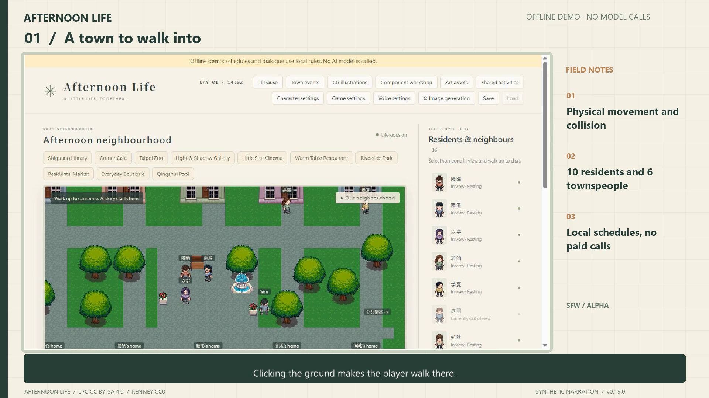

# 午後の共同生活 · Afternoon Life

[繁體中文](README.zh-TW.md) · [简体中文](README.zh-CN.md) · **日本語** · [English](README.md)

初回起動は **English** が既定です。保存済みの言語選択は保持します。

十人の成人住人、人間が操作するプレイヤー、動き続ける町を持つ見下ろし型ピクセル生活サンドボックスです。各AIは本人に許された観察、目標、記憶だけを受け取ります。モデルサービスは共用できますが、全知の人物コンテキストは共用しません。

**遊べるアルファ版：v0.24.0。** 完成済み商用作品や、長期物語品質が実証されたエンジンではありません。露骨なコンテンツは無効です。

[](https://github.com/tray11415-cloud/afternoon-life/releases/download/v0.19.0/afternoon-life-guide.en.mp4)

[繁体字紹介動画 · 5:20](https://github.com/tray11415-cloud/afternoon-life/releases/download/v0.19.0/afternoon-life-guide.zh-TW.mp4) · [英語紹介動画 · 5:28](https://github.com/tray11415-cloud/afternoon-life/releases/download/v0.19.0/afternoon-life-guide.en.mp4) · [簡体字紹介動画 · 7:37](https://github.com/tray11415-cloud/afternoon-life/releases/download/v0.20.0/afternoon-life-guide.zh-CN.mp4) · [リリース](https://github.com/tray11415-cloud/afternoon-life/releases/tag/v0.24.0)

既存動画はv0.19／v0.20の独立したオフライン世界を記録しています。合成音声、字幕、章立てと実際の操作を含み、実AI会話や現場SD生成を示すものではありません。[動画の章・字幕・記録範囲](docs/WALKTHROUGH.ja.md)。

## 複数LoRAと精修設定 · v0.24

キャラクター工房は最大八つの画風欄、独立した重み、トリガー、有効化、追加画風の順序に対応します。Refiner／ADetailer／Hires.fixは折り畳み欄にあり、同じ人物配合に保存します。各機能はネイティブテンプレート継承、人物設定使用、明示的無効を選べ、用途も個別指定できます。

WebUI／ForgeではRefinerベースモデルと切替比率、稼働中サービスの容量内で最大四段のADetailer、検出器、プロンプト、マスク、サンプラー、検証済み追加JSONを設定できます。文字生成はネイティブHires.fix、参照差分とCGは拡大後に二回目の拡散を行います。拡大器は既存ローカル資源のみで、出力は最大2048pxです。ComfyUIは複数LoRAと番号付きネイティブバインドに対応し、三つのWebUI専用精修欄はネイティブワークフローを継承します。


画像は明示された独立SDモックとライセンス付きLPC素材です。追加要求テスト16件が通過し、ローカルreForgeで二つの画風、ADetailer、同じ既存ベースモデルのRefiner、二種類の高解像度処理による小型SFW画像も得られました。これはAPI受付とPNG出力の確認であり、顔検出の成功や長期の人物一致品質を保証しません。実SD画像、資源一覧、私的状態は公開しません。

## 人物別チェックポイントと画風 · v0.23

プロンプトの近くで人物ベースモデル、画風LoRA、重み0–1.5、トリガー語を個別に保存できます。共通ベースモデルの継承も選べます。人物LoRAと衣装LoRAは別で、「保存してこの人物を完成」で同じ配合から立ち絵、歩行画像、CGを作り、以前の素材も残します。

選択欄には接続環境の利用可能なローカル資源を表示します。既知の構造不一致は理由付きで生成を止めます。WebUIは要求単位でベースモデルを上書きし処理後に復元、内蔵ComfyUIは選択LoRAを順に結びます。ネイティブComfyUIには `style_lora/style_weight` バインドが必要で、なければ内蔵テンプレートを使います。不明な学習情報は互換性を保証しません。


画像は独立UI環境のLPCモック結果で、新規SD生成画像ではありません。

## 統一キャラクター工房 · v0.22

人物を選び、名前と一つの人物プロンプトを入力して保存します。本人の私的設定を確定し、立ち絵表情、四方向歩行、一枚のCGを予約します。一致する完成結果は自動適用し、未完成部分は理由付きで再試行できます。以前の素材、世界の進行、持ち物、他の人物は保持します。

髪、体型、色、性格、目標、任意の背景、AI下書き、カードを一画面にまとめています。LoRAは任意で、明示したローカル `<lora:filename:0.8>` タグだけを解決します。詳細／ネイティブSD設定も残し、新規ゲーム用テンプレートは新しいセーブの作成後に生成します。既存動画は以前の版です。

[画像付きプレイ百科](docs/PLAYER_GUIDE.ja.md) · [人物処理とAPI](docs/CHARACTER_ATELIER.ja.md)。ゲーム内百科：`http://127.0.0.1:8765/guide.html`。

## 遊ぶ

**Python 3.12以上とPillow**が必要です。オフラインデモにゲームエンジン、Node.js、APIキー、SDモデルは不要です。

```powershell
git clone https://github.com/tray11415-cloud/afternoon-life.git
cd afternoon-life
python -m pip install -r prototype/requirements.txt
cd prototype
python -m lifebox.play --demo
```

**http://127.0.0.1:8765/** を開きます。Windowsでは依存導入後に `prototype/play-demo.cmd` も使え、実ゲームと分離するため8766で起動します。`play.cmd` はキー設定があればxAI、なければオフラインで起動します。明示的デモと実ゲームは別セーブです。二つ目のCLIには別の `--port` を指定します。

WASD／矢印キー、地面クリックで移動し、人物や物の近くでEを押します。建物には入口から入り、施設ボタンは移動経路を作ります。

ゲーム設定は **繁体字／簡体字／日本語／英語** に対応し、保存した言語を新しい会話の指示にも使います。人物名、作者設定、過去の台詞、出典記事、ネイティブSD画面は原文のままです。TTSの声と読み上げ言語は別に選びます。

オフラインデモは画面に明示し、ローカル日課と固定例文を使います。LLMではなく、課金モデルを呼びません。

## 開始メニューとキャラクター工房 · v0.20

続行、新しいゲーム、キャラクター工房、設定、手動ロードを提供します。続行は最新位置を保持します。新しいゲームは先にテンプレートを開き、明示操作で世界を作成し、以前のセーブを復元用に保管します。

プレイヤーと十人の住人を個別に編集できます。外見識別情報、顔／体型、髪、服、性格、任意の背景、AI／カードを扱います。外見変更は任意で、初期状態では既存美術を保持します。八髪型、髪／肌／初期服色、制限付き輪郭倍率は四方向歩行プレビューに反映します。顔と目はSD記述に使うもので、3D造形ではありません。購入服は専用配色を保持します。

既存人物の変更は適用前にプレビューし、新規ゲーム用テンプレートとは別です。手動AI下書きは本人の設定と短い指示だけを送り、既存の行動モデルと共通予算を使い、自動適用しません。オフラインは明示された例です。JSONカードは人物設定だけで、記憶、キー、重み、画像を含みません。読み込みはプレビューと適用が必要です。衣装分類からSDに進み、人物ごとにモデルを明示して結びます。

画面、操作、音声、AI、言語、保存に設定を分類します。倍率、名前、ミニマップ、大きな文字、動きの軽減、設定中の停止を保存できます。開始メニューはこのページの時間進行を止めますが、別のゲームページは共通世界を進められます。[人物カードとプレビューAPI](docs/CHARACTER_ATELIER.ja.md)。

## できること

- 22地図と10公共施設：図書館、カフェ、動物園、美術館、映画館、食堂、公園、市場、服屋、プール。
- 共同活動への招待。本人が承諾／拒否し、移動し、個別に払い、実参加分だけを記憶します。脚本NPCは別の日程と固定台詞を持ちます。
- 勤務、レシピ制作、委託販売、消耗品購入、着替え。金銭と物は完了イベントで確定し、台詞で作れません。
- 名前、成人年齢、性別、性格、目標、任意背景、外見の編集。既存進行を保持し、工房履歴から復元できます。
- 部品工房による美術、形状、操作、目録、日程、経済規則、モデル／ツール置換。固定ID、適合確認、プレビュー、復元で既存セーブを保持します。
- ローカルWebUI／Forge／reForge／ComfyUIで人物LoRA、立ち絵差分、四方向歩行、SFW CGを生成。資源一覧、ネイティブテンプレート、結果確認、人物／衣装別適用に対応し、重みは同梱しません。
- Windows／ブラウザーまたは対応ローカルTTS。プレイヤーが聞いた台詞だけを読み、ロード時に過去会話を全再生しません。

## 実AIとローカル接続

**ゲーム設定 → AIと生成 → APIキー・SDパス設定** でxAIキー、モデル、SD環境を指定できます。保存は即時反映し、接続テストは別ボタンです。[接続手順](docs/CONNECTION_SETTINGS.ja.md)。環境変数も使えます。

`XAI_API_KEY` をプロセス環境に設定し、`--demo` なしで起動します。

```powershell
cd prototype
python -m lifebox.play
```

キーはソースコードに書かないでください。既存Windows DPAPI形式も対応します。会話はGrok 4.3、行動はgrok-build-0.1が既定で、アカウントの利用可否に依存します。永続使用量は既定50回／推定US$0.05が上限で、ロードと再起動でリセットしません。価格表に基づく推定は請求保証ではありません。

ローカル日課はモデルを呼びません。自主AI会話は初期無効です。会話、行動、記憶、置換ツールは別adapterを使え、人格や記憶を作り直しません。

SDは任意です。サービスを起動して環境を選び、人物LoRAを個別指定します。水着画像には水着LoRAも必要です。重み検出はサービス／フロー互換を保証しません。ニューラル背景除去には既存の対応実行環境とローカル重みが必要で、自動ダウンロードはしません。

ツール契約は `lifebox.decide.v1`、`lifebox.interact.v1`、`lifebox.replace.v1` です。`GET /api/components/schema` が六つの置換関数schemaを提供し、`tools/components_cli.py` で確認、準備、適用、復元、出力できます。ローカルAPIはゲームtokenを要求して別Originの書き込みを拒否し、読み込んだPython／JavaScriptを実行しません。

## 現在の制限

- 長期性格一致、自由物語、大規模性能は未検証です。日課、目標、制作は小さな作者規則／レシピです。
- 標準記憶はローカル語句／イベント検索です。意味埋め込みは任意で、実際のサービスが必要です。
- 施設目録は出典スナップショットで、リアルタイム在庫や現在展示を保証しません。映画理解はあらすじ／感想文によります。
- 生成外見識別情報、表情、衣装、歩行には目視確認が必要です。ControlNetと参照は一致を改善できますが保証せず、拡張／モデルには不適合もあります。
- 置換は32px格子、場面サイズ、既存IDを維持します。世界形式の拡張は別の移行が必要です。
- 主な実測環境はWindowsです。Windows音声とSD起動補助はWindows用で、学習済みTTSモデルは同梱しません。

## 開発

```powershell
cd prototype
python -m unittest discover -s tests
cd ..
python tools/test_atelier.py
python tools/test_release.py
python tools/test_character_customization.py
python tools/test_components.py ComponentsTests
```

テストは隔離世界と偽／ローカルサービスを使い、実キーを要求しません。[過去のリリース確認記録](docs/RELEASE_REVIEW.ja.md)。

`prototype/lifebox` はイベント、権限、生活規則、adapter、`prototype/web` はCanvas画面、`prototype/data` は目録とmanifestです。`tools` は美術生成補助と確認用です。保存、キー、生成キャッシュ、機器設定は無視対象の `work/` に置きます。

## クレジットとライセンス

独自コードはMITです。美術は別ライセンスで、LPC構成は上流選択肢と署名を保持したCC BY-SA 4.0です。[LPC-CREDITS.txt](prototype/web/assets/LPC-CREDITS.txt) と [ASSET_LICENSES.md](ASSET_LICENSES.md) を参照してください。KenneyはCC0です。コードライセンスはモデル重みや外部作品に自動適用されません。

会話指針は [Lieflat Less AI Tone](https://github.com/larashero3-dotcom/lieflat-less-ai-tone)（MIT）、記憶設計は [Spatial Memory Engine](https://github.com/jack66g/spatial-memory-engineagent)（Apache-2.0）を参考にしています。通知は `docs/third-party/` に保持し、上流システム全体の統合は主張しません。
