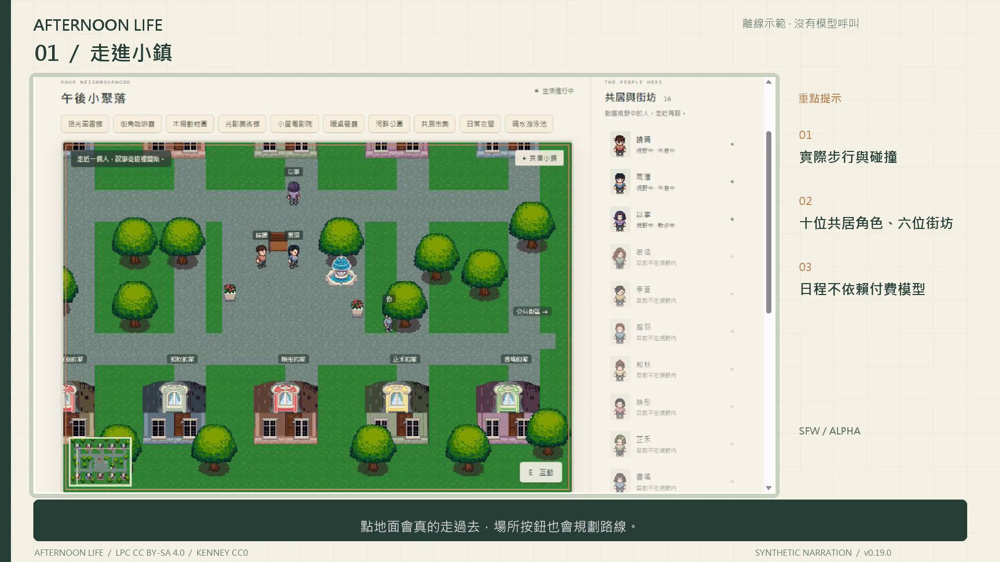

# 午後共居 · Afternoon Life

**繁體中文** · [简体中文](README.zh-CN.md) · [English](README.md)

俯視角像素生活沙箱：十位成年共居角色、一位由你控制的玩家，以及持續運作的小鎮。每位 AI 只取得自己的觀察、目標與記憶；可以共用模型服務，但不共用全知人格。

**目前是可玩的 alpha：v0.20.0。** 這是生活模擬實驗，尚非完成的商業 galgame，也尚未驗證成熟的長期故事品質。露骨內容入口關閉。

[](https://github.com/tray11415-cloud/afternoon-life/releases/download/v0.19.0/afternoon-life-guide.zh-TW.mp4)

[中文解說導覽 · 5:20](https://github.com/tray11415-cloud/afternoon-life/releases/download/v0.19.0/afternoon-life-guide.zh-TW.mp4) · [English walkthrough](https://github.com/tray11415-cloud/afternoon-life/releases/download/v0.19.0/afternoon-life-guide.en.mp4) · [下載版本](https://github.com/tray11415-cloud/afternoon-life/releases/tag/v0.20.0)

上述繁中與英文影片記錄 v0.19；影片包含合成配音、字幕、八個章節及獨立離線世界的實際遊戲操作。沒有宣稱現場模型對話或 SD 生圖。[章節、字幕與拍攝說明](docs/WALKTHROUGH.md)。


[简体新版导览 · v0.20 · 7:37](https://github.com/tray11415-cloud/afternoon-life/releases/download/v0.20.0/afternoon-life-guide.zh-CN.mp4)

## 開始玩

安裝 **Python 3.12 以上**與 **Pillow**。離線試玩不需要遊戲引擎、Node.js、API 金鑰或 SD 模型。

```powershell
git clone https://github.com/tray11415-cloud/afternoon-life.git
cd afternoon-life
python -m pip install -r prototype/requirements.txt
cd prototype
python -m lifebox.play --demo
```

打開 **http://127.0.0.1:8765/**。Windows 安裝依賴後也能雙擊 `prototype/play-demo.cmd`，此啟動器使用 **8766**，與正式遊戲分開。`play.cmd` 在有金鑰時使用 xAI，沒有則使用離線示範；兩者存檔分開。用命令開第二個遊戲時，請指定另一個 `--port`。

**WASD／方向鍵**移動、點地面尋路、靠近人物或物件按 **E** 互動。走到門口即可進屋；場所按鈕會安排實際路線，不會瞬移。

「遊戲設定」可選 **繁體中文／简体中文／日本語／English**，保存後影響介面與新生成的 AI 台詞。人物名字、自訂背景、歷史台詞、来源文章和原生 SD 畫面保留原文。TTS 聲線與朗讀語言另行選擇。

離線示範有明確標示，使用本機日程及固定示範台詞，**沒有呼叫 LLM，也沒有付費模型請求**。

## 開始選單與人物工坊（v0.20）

開始畫面提供繼續、新遊戲、人物工坊、遊戲設定及手動讀檔。「繼續」保留最新位置；「新遊戲」先編輯模板，勾選建立存檔後才開始，原存檔會封存，可在工坊恢復。

人物工坊按基本資料、臉與身形、髮型、服装、個性、背景及 AI／人物卡分類。男主與十位角色各自編輯；原人物未啟用自訂外觀時沿用原素材。啟用後可調整八種髮型、髮色、膚色、初始衣褲色和簡化身形，預覽四方向與行走。臉型與眼色供 SD 身份描述使用，沒有 3D 捏臉；身高在像素圖中是有界的輪廓縮放。已購買衣服繼續使用自己的配色。

目前人物先預覽再套用；新遊戲模板另存。AI 草擬只在手動點擊時處理選定人物，使用既有行動模型與共用帳本上限，不傳整個世界。離線模式提供明示本機範例。JSON 人物卡只含設定，不含世界記憶、金鑰、LoRA 或圖片；匯入後仍需预覽套用。SD 可由服装分類進入，需另外逐人綁定模型。

遊戲設定分為畫面、操作、聲音、AI、語言與存檔。可保存視野縮放、人物名稱、小地圖、較大文字、減少動畫及設定時暫停。主選單一律暫停這個遊戲頁的心跳；多開另一個頁面仍可推進同一個世界。TTS 聲線與朗讀語言獨立選擇。[人物卡與預覽接口](docs/CHARACTER_ATELIER.md)。

## 可以做什麼

- 探索 **22 張地圖、10 個公共場所**：圖書館、咖啡廳、動物園、美術館、電影院、餐廳、公園、市集、衣服店與泳池。
- 發出共同活動邀約。每人自己回覆、步行集合、分別付款，只記得實際參與的內容。一般 NPC 有獨立日程與固定台詞。
- 打工、依配方創作、寄售作品、買消耗品與换裝。金錢與物品由完成的世界事件產生，不能只靠台詞宣稱取得。
- 客製玩家和十位共居角色的名字、成年年齡、性別、性格、目標、可選背景與外觀描述。現有人物先預覽再套用，保留進度，可從工坊歷史還原；新遊戲模板另存。
- 在「部件工坊」更換圖片、場景幾何、互動、商品、日程、經濟規則和模型／工具接口。固定 ID、相容性驗證、預覽及還原保護原存檔。
- 連接本機 **WebUI／Forge／reForge／ComfyUI**，用角色 LoRA 生成立繪、表情差分、四方向像素圖及一般 CG。可盤點資源、匯入完整原生模板，確認結果後按人物與穿著套用；不附模型權重。
- 選擇 Windows／瀏覽器本機聲線或相容本機 TTS。只朗讀玩家實際聽到的台詞，讀檔不重播全部歷史。

## 真實 AI 與本機服務

在程序環境設定 `XAI_API_KEY`，不加 `--demo` 啟動：

```powershell
cd prototype
python -m lifebox.play
```

不要把金鑰寫進原始碼。也支援既有的 Windows DPAPI 金鑰格式。預設對話用 **Grok 4.3**、行動決策用 **grok-build-0.1**，仍取決於帳號與服務可用性。帳本預設最多 50 次／估計 US$0.05；讀檔與重啟不重置。金額按 adapter 的價格表估算，不代表帳單保證。

固定日程不呼叫模型；自主 AI 公共會話預設關閉。對話、行動、記憶與替換工具可分別選 adapter，不會因此換掉人格或重置記憶。

SD 是可選功能。啟動本機服務，在「生圖設定」選安裝資料夾，再逐人綁定 LoRA。泳裝生成另需泳裝 LoRA。找到權重不代表服務與工作流相容；神經去背也需現有相容環境及本機權重，不會自動下載。

本機工具契約為 `lifebox.decide.v1`、`lifebox.interact.v1`、`lifebox.replace.v1`。`GET /api/components/schema` 提供六種替換函數定義；`tools/components_cli.py` 可檢查、準備、套用、還原及匯出。API 需要遊戲 token，拒絕跨來源寫入，不執行匯入的 Python／JavaScript。

## 目前限制

- 長期個性一致性、開放故事品質與大規模效能尚未驗證；原生日程、目標與創作仍使用小型規則及配方。
- 預設記憶是本機詞彙／事件檢索；語意嵌入需要真正的服務。
- 場所目錄是來源快照，不是即時庫存或保證當期展覽。電影理解依劇情／心得文字，沒有宣稱以視覺看完整部電影。
- 生圖的人物、服裝、表情與步伐仍需預覽。ControlNet 和參考圖能改善一致性，不能保證；部分 SD 擴充或模型架構可能不相容。
- 替換目前維持原 32px 格網、場景尺寸和既有 ID；擴張世界格式需另做遷移。
- 主要驗證平台為 Windows；Windows 語音和桌面 SD 啟動工具限 Windows，不附已訓練 TTS 模型。

## 開發與驗證

```powershell
cd prototype
python -m unittest discover -s tests
cd ..
python tools/test_atelier.py
python tools/test_release.py
python tools/test_character_customization.py
python tools/test_components.py ComponentsTests
```

測試使用隔離世界、假模型或本機測試服務，不需要真實金鑰。詳細檢查見 [docs/RELEASE_REVIEW.md](docs/RELEASE_REVIEW.md)。

`prototype/lifebox` 管理世界事件、權限、生活規則與接口；`prototype/web` 是 Canvas 介面；`prototype/data` 是目錄與素材清單。`tools` 提供建置與驗證工具。存檔、金鑰、生成快取與本機設定都放在不發布的 `work/`。

## 素材與授權

本專案原始程式採 MIT；**美術另有授權**。LPC 人物／場景改作依 CC BY-SA 4.0 分享，完整上游授權選項與署名在 [LPC-CREDITS.txt](prototype/web/assets/LPC-CREDITS.txt) 及 [ASSET_LICENSES.md](ASSET_LICENSES.md)。Kenney 素材保留 CC0 標示。程式授權不涵蓋模型權重或外部內容。

對話風格參考 [Lieflat Less AI Tone](https://github.com/larashero3-dotcom/lieflat-less-ai-tone)（MIT）；記憶設計參考 [Spatial Memory Engine](https://github.com/jack66g/spatial-memory-engineagent)（Apache-2.0）。通知保留在 `docs/third-party/`；沒有宣稱完整整合兩個上游系統。
