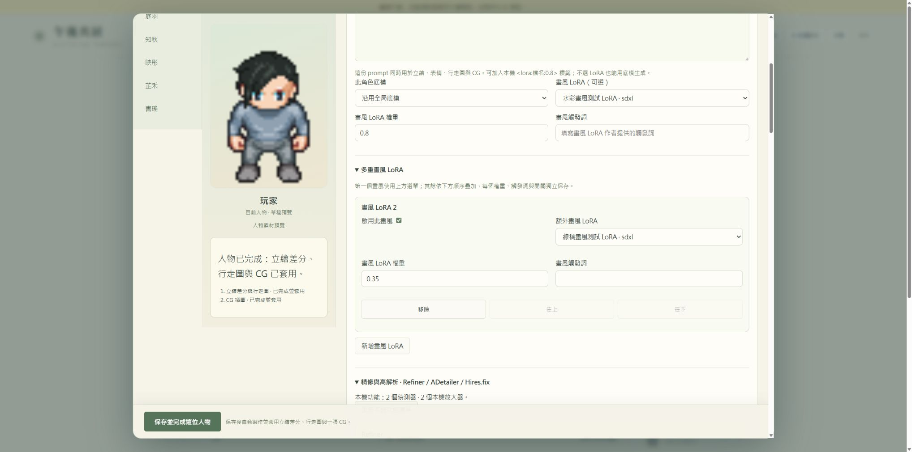
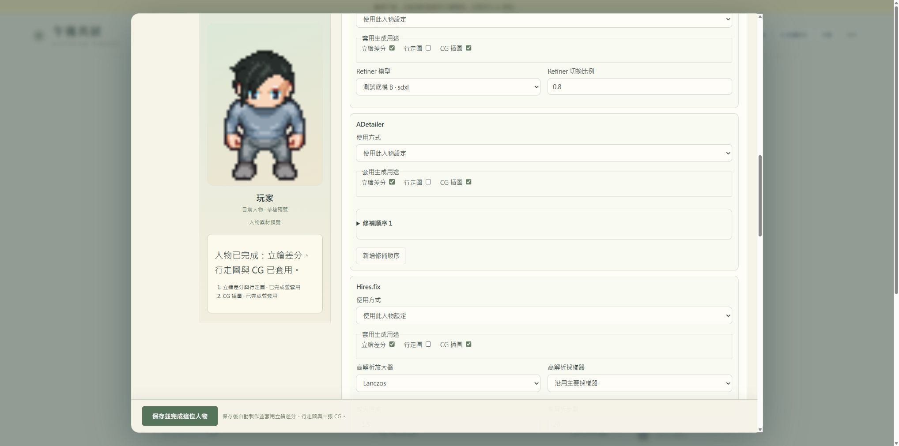
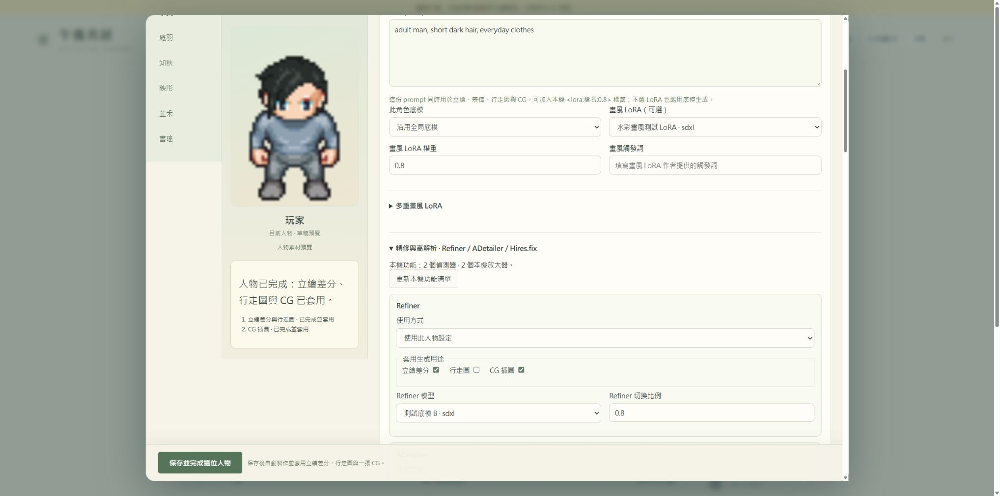
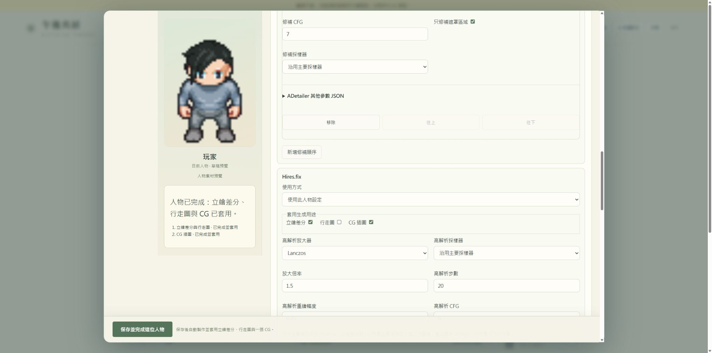

# 午後の共同生活 プレイ百科 · v0.24

[繁體中文](PLAYER_GUIDE.zh-TW.md) · [简体中文](PLAYER_GUIDE.zh-CN.md) · **日本語** · [English](PLAYER_GUIDE.en.md)

一人につき一つの設定。町の暮らしは続きます。画像は独立したオフライン環境、明示されたSDモック、クレジット付きLPC素材です。私的な人物設定や新たなSD生成画像ではありません。既存の画像は繁体字中国語の画面ですが、以下の説明は日本語です。

## 午後を始める

### 入口を選ぶ

進行中のデータには「続ける」を使います。「新しいゲーム」は人物テンプレートを開き、明示的に新規セーブを作成します。以前のセーブは保管され、キャラクター工房から復元できます。キャラクター工房では男性プレイヤーと十人の住人を編集できます。

### 初めて遊ぶ

オフラインデモには会話APIもSDも不要です。固定の例文とローカルの日課を使います。実際のAI会話にはモデル接続、SD画像には起動中のローカルSDが必要です。画面のオフライン表示で現在のモードを確認できます。

### 保存と復元

進行状況は自動保存され、「保存」で手動版も残せます。ロードしてもAPI使用量は戻りません。新しいゲームは旧セーブを保持し、復元すると元の人物と世界の進行に戻ります。

## 一つの画面で人物を完成させる

### 名前・プロンプト・保存

プレイヤーか住人を選び、重複しない名前と人物プロンプトを入力して「保存してこの人物を完成」を押します。人物設定は直ちに保存され、立ち絵差分、四方向の歩行画像、CG一枚が同じSDキューに入り、一致する結果が完成すると自動適用されます。

### 固定した外見を書く

例えば adult woman, long black hair, brown eyes, round glasses, casual long-sleeved clothes のように固定した特徴を記述します。背景と動作は生成詳細とCG場面に入れ、すべての歩行画像にカフェ背景が入ることを避けます。年齢と性別は人物欄で指定し、人物は成人である必要があります。

### LoRAは任意

チェックポイントとプロンプトだけでも生成できます。ローカルの人物LoRAも選べます。`<lora:filename:0.8>` タグは一致する唯一のローカルファイルを解決し、一つ目を人物、二つ目を衣装に使います。未検出、同名、不適合は理由を表示し、別のモデルを推測しません。トリガー語は作者の指定に従います。

### 既存の代替外見機能

同じ画面で顔、目、肌色、身長、体型、八種類の髪型、髪色、初期衣装色、性格、口調、目標、任意の背景、AI下書き、人物カードを編集できます。外見詳細を有効にするとSD記述と標準ピクセル代替画像に反映され、無効なら人物プロンプトが中心になります。

### 名前と背景

プレイヤーと各住人の名前は最大32文字で、重複不可です。名簿、会話、招待、SD/TTS選択欄に反映されますが、固定IDと過去の記憶は保持します。背景は本人だけの作者入力であり、収入、交際、過去の出来事を新しく作ることはありません。

### カードとAI下書き

AI下書きは任意の手動操作で、結果は同じ編集画面に入ります。実AIでは既存のモデルと予算を使い、オフラインでは明示された例を返します。JSON人物カードは外見と背景を含みますが、キー、世界の記憶、財布、モデル重み、画像を含みません。

## 進行・再試行・素材の選択

### 各段階を確認する

左側に立ち絵／歩行画像、CG、適用状態を表示します。GPUが忙しい場合はキューで待ちます。SD未接続、チェックポイント未選択、ネイティブバインド不足の場合も人物設定は保存され、原因を表示します。修正後に未完成部分を再試行できます。

### 自動適用の条件

人物、保存済み設定、LoRA配合、実際の服装を照合します。生成中に人物や服装を変更すると古い作業は失効し、新しい外見を上書きしません。旧ファイルは残ります。名前だけの変更なら適合する完成素材を再利用できます。

### 別の結果を選ぶ

「素材結果」を開き、立ち絵、表情、歩行表、CGの縮小画像を確認します。別の表情や過去の素材を選び、単独で再生成することもできます。単独の再生成結果は完成後に手動で選択します。

### 停止と復元

停止はその人物の今回の仕事だけに作用し、他の人物のSD作業には影響しません。標準／読み込み済み画像への復元でも生成ファイルは残ります。新しい保存は以前の自動適用計画を置き換え、部分失敗時にも完成素材を保持できます。

## 移動・会話・公共施設

### 移動と操作

WASD、矢印キー、地面クリックで移動します。施設ボタンは実際の歩行経路を作り、入口を通って建物に入ります。人物や物の近くでEを押して操作します。画面外の私的な活動をプレイヤーの知識にはしません。

### 会話する

人物に近づいてEを押し、会話欄に入力します。会話は設定中のモデルを使います。オフラインの例文はローカル規則であり、LLM応答ではありません。住人には独自の口調、目標、欲求、記憶があり、仕事、散歩、招待の拒否も行います。

### 訪問できる場所

図書館で原典を読む、カフェで飲み物を買う、動物園で観察する、美術館の展示を見る、公開無料映画を見る、食事、公園散歩、市場取引、服の購入、プールでの水泳ができます。到着後に利用可能な物や品目を選び、費用と時間を確認します。

### 外部作品の理解

施設には出典リンク、文章紹介、要約を保存します。住人は実際に参加した活動をその文章から理解します。目録は保存時点の情報であり、リアルタイム在庫や現在の展示を保証しません。本、映画、サイトは元の出典で開きます。

## 共同活動・近隣住民・町のイベント

### 複数人を招待する

「共同活動」で名称、場所、共用品目、同伴者、集合時刻を選び、招待します。各人が独立して承諾／拒否し、現地に歩いて行き、自分の料金を払います。主催者と少なくとも一人の同伴者が到着してから始まります。

### 欠席と中止

開始時刻から最大十分待ちます。欠席者には活動内容、グループ会話、支払いの記憶を与えません。開始前の中止は無料です。開始後に離れても購入料金は自動返金されません。無料散歩も共同活動にできます。

### NPCとイベント

「町の活動」には祭り、展示、脚本NPC、自主会話を表示します。AI住人は他のAIや通常NPCと出会えます。参加者や聞いた本人だけが相応の記憶を得ます。部品工房からNPC脚本と公共イベント定義を読み込めます。

## 持ち物・収入・市場・衣装

### プレイヤーの持ち物

「ポケットと日常」を開くとコイン、欲求、収入、物品数量を確認できます。「一つ使う」で消耗品を一個減らし、材料は制作に使います。購入物が持ち物になるか活動を直接始めるかは品目の操作方式によります。

### 働く・作る

仕事場で勤務を終えてから賃金を受け取ります。自宅で材料を使って作品を作り、市場に委託販売できます。住人も独自の収入、在庫、欲求、仕事を持ち、プレイヤーの財布とは別です。

### 市場取引

作品の数量と価格を指定して出品します。実際に購入されたときだけ売り手に収入が入ります。住人の作品を買うことや、自分の委託品を撤回することもできます。出品しても即時売却を保証しません。

### 衣装とプール

買った服は本人の衣装棚に入り、着替え可能な部屋で着用します。歩行画像とSD配合は実際の服装を参照します。水泳には水着が必要で、そのSD生成には対応する衣装LoRAも必要です。所有しているだけでは着用扱いになりません。

## 詳細SD設定とネイティブ固定テンプレート

### 初回の接続

「ゲーム設定 → AIと生成 → APIキー・SDパス設定」で環境またはパスを選び、実際のローカルURLを入力して接続し、チェックポイントを選びます。保存済み接続のテストは別のボタンです。モデルが見つかってもサービスが動いているとは限りません。キャラクター工房はこの設定を共用します。

### ネイティブSDで設定済みの場合

外側の保存ボタンは埋め込みSDのフォームを取得しません。その設定で生成した元PNGを保存し、SD窓を閉じて「ネイティブSDから新テンプレートを保存」でPNG、PNG Info、完全なAPI JSONを読み込みます。保存後に立ち絵／ピクセル／CGの用途を指定し、その選択も保存します。

### ADetailerと後処理

ネイティブテンプレートはAPIで表現できる拡張設定を保持します。PNGはSDが書いた情報だけを持つため、未記録のADetailer等は完全なAPI payloadが必要です。ゲームはコピーした要求のプロンプト、ネガティブ、Seed、ベースモデル、人物を置換します。統一人物処理ではWebUI ADetailerの正向記述も人物／表情に追従し、検出器、マスク、ネガティブなどを保持します。元テンプレートとネイティブSDフォームは書き換えません。

### ComfyUIと用途

Export (API)ワークフローまたは完了履歴を読み込み、人物、ベースモデル、LoRA、参照画像、denoiseを結びます。人物LoRAノードがあるネイティブフローではそのLoRAが必要です。プロンプトだけなら内蔵フローを使えます。立ち絵、歩行、CGは別のテンプレートを選べます。イラストの構図が全方向歩行に適するとは限りません。

### テンプレート変数

内蔵テンプレートでは `{identity}`、`{outfit}`、`{expression}`、`{direction}`、`{pose}`、`{scene}` を使います。人物プロンプトが外見識別情報、実際の服が衣装、差分が表情、CGが場面を加えます。立ち絵差分は再利用でき、CGは一つの構図を表現します。

## 音声・言語・使用量

### 一人ずつの声

「音声設定」でWindows／ブラウザーのローカル声、Kokoro、対応ローカルTTSを選びます。人物、読み上げ言語、声を指定し、保存または試聴します。ニューラルTTSには対応サービスの起動が必要で、モデル選択だけでは重みをインストールしません。

### 音声は翻訳ではありません

TTS言語は声と発音を決めます。繁体字、簡体字、日本語、英語は画面、文書、新しい会話の言語指示に対応します。人物名、作者の背景、過去の台詞、出典記事、ネイティブSDプロンプトは原文を保ちます。

### 使用量を管理する

行動、会話、記憶、SD、TTSは別の接続です。ローカルSDと音声は会話API枠を使いません。AI下書きと実際のモデル会話には既存の上限が適用されます。「使用量とゲーム情報」で帳簿を確認できます。中止やロードで実行済みAPI使用量は消えません。

## 地図・美術・操作・AIを置き換える

### 指示で置換する

「部品工房」で種類と対象を選び、「名前を午後の庭に変更」などの指示を入力します。置換案を作り、差分と適合性を確認してから適用します。例の画像はプレビューだけで、世界はまだ変更していません。

### 置換できるもの

地図の衝突、入口、物体、背景、PNG、施設目録、品目、衣装配合、人物、NPC脚本、イベント、規則、モデル接続、自作ツール、配色を置換できます。完全なJSONと部品パッケージを読み込み／出力できます。

### 復元と自作ツール

履歴の旧値から復元案を作って適用します。固定IDで記憶、取引、在庫を維持します。内蔵指示解析は定義された操作に対応し、複雑な要求にはローカル置換AIを接続できます。文章を任意のコンピュータープログラムとして実行しません。

## ゲーム設定とよくある質問

### 画面と操作

視野倍率、名前、ミニマップ、動きの軽減、大きな文字を設定できます。衝突や記憶は変わりません。一時停止で観察できますが、明示したゲーム操作は規則どおり時間を進めます。

### 保存しても画像が出ない

段階ごとの理由を確認します。ベースモデル未選択、SDオフライン、LoRA系列不適合、水着バインド不足、ComfyUIバインド不足では人物を保持して生成だけを止めます。修正後に再試行してください。重複名、未成年、無効プロンプトは保存前に拒否します。

### 想定と違う画像

人物プロンプトかLoRAを編集して再保存します。表情と姿勢テンプレートは詳細SDで変えます。Seedと参照は変化を減らせますが、完全に同じ顔や理想的な動作を保証しません。名前、外見、性格は別の欄で、画像が人物背景を作ることはありません。

### 画像が示す範囲

百科の画像は独立したオフライン世界のものです。人物素材の処理は明示されたSDモックとクレジット付きLPC画像で画面と自動適用を示し、実SDの品質を示しません。私的な人物、モデル、セーブ、ワークフローは公開していません。

## 画面参考と素材クレジット

キャラクター工房の名簿、プレビュー、分類、カードはAI＊少女の手引きの構成を参考にしています。このプロジェクトは独自の画面とピクセル／SD方式を使い、同作のコード、美術、3D人物素材を含みません。

[AI＊少女の手引き](https://aisteam.illusion.rip/manual/readme_jp.html) · [美術ライセンス](../ASSET_LICENSES.md)

## 人物ごとのベースモデルと画風 · v0.23

人物を選び、プロンプト下の人物チェックポイントと画風LoRAを指定します。ベースモデルは共通設定を継承でき、画風は任意です。作者の重み／トリガー指定に従って「保存してこの人物を完成」を押します。立ち絵差分、歩行、CGに同じ配合を使い、他人の設定は変えません。ベースモデルの上書き解除は共通ベースモデルの継承を選んで保存します。

この独立UI画像はクレジット付きLPCモック結果です。選択欄には現在の環境で使える資源だけを表示し、既知の構造不一致は生成を止めます。ネイティブComfyUIには `style_lora/style_weight` の結び付けが必要で、ない場合は内蔵テンプレートを使います。

## 複数画風・Refiner・ADetailer・Hires.fix · v0.24

1. 人物を選びます。最初の画風は上の欄にあり、「複数画風LoRA」で追加画風の重み、トリガー、有効化、順序を指定できます。最大八つで、同じ画風を追加せず重みを調整します。
2. 「精修と高解像度」を開き、ローカル機能を更新して接続中サービスの検出器、サンプラー、ローカル拡大器を取得します。
3. 各機能にネイティブテンプレート継承、人物設定使用、明示的無効を選び、用途を指定します。Refinerはベースモデルと切替比率、ADetailerは順序付き検出器処理と人物／表情追従、追加の検証済みJSONを設定します。
4. Hires.fixはローカル拡大器、倍率、Steps、denoise、CFG、サンプラーを指定します。文字生成はネイティブHires.fix、参照差分とCGは拡大後に二回目の拡散を行い、ADetailerは最後だけ実行します。歩行画像は初期用途に含まず、必要なら選択できます。
5. 最後に「保存してこの人物を完成」を一度押します。すべて同じ配合に保存され、選んだ用途に反映し、旧ファイルとネイティブテンプレートを保持します。

出力は最大2048pxで、未配置の拡大器はダウンロードしません。ネイティブComfyUIの複数画風には `style_lora_2/style_weight_2` から `style_lora_8/style_weight_8` の結び付けが必要です。Refiner／ADetailer／Hires.fix画面はWebUI／Forge向けで、ComfyUIでは継承を選び自分のネイティブワークフローに設定します。

## APIキーとSDフォルダーの設定

「ゲーム設定 → AIと生成 → APIキー・SDパス設定」でxAIキー、会話／行動モデルを指定して保存します。Windowsは保存キーを暗号化でき、空欄なら既存キーを保持します。保存は即時反映し、会話を生成しません。保存済み接続のテストは別のボタンです。

検出環境、フォルダー選択、絶対パス入力でSDを指定します。`webui.py`、または `main.py` と `comfy` を含むフォルダーを選び、モデルフォルダーだけは選びません。実際のローカルURLを入力します。WebUIは通常 `http://127.0.0.1:7860`、この環境のreForgeは7861、ComfyUIは通常8188です。接続保存、ベースモデル選択、接続テストの順に進めます。ローカルSDにAPIキーは不要で、元の位置にある重みを使います。

[詳しい接続手順](CONNECTION_SETTINGS.ja.md)
