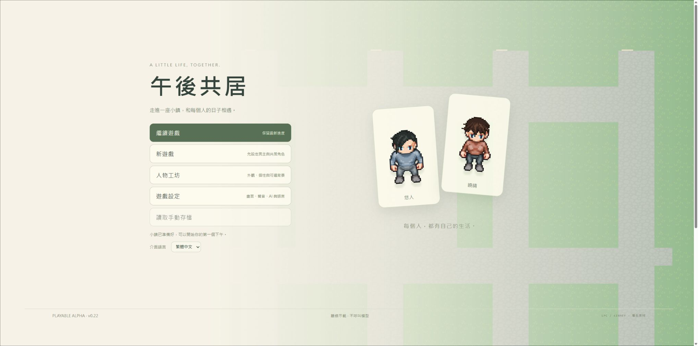
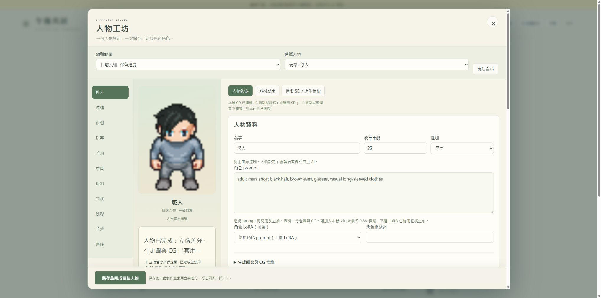
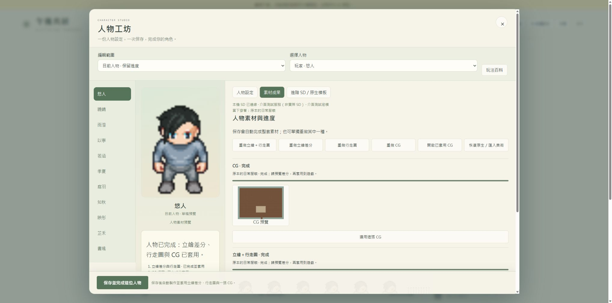
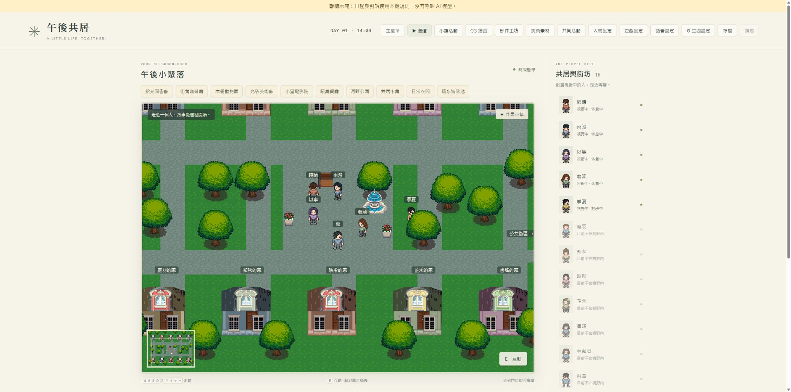
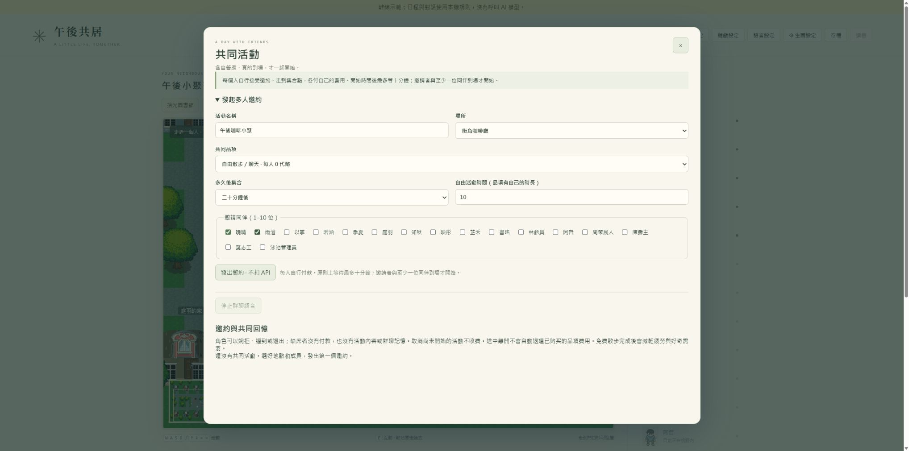
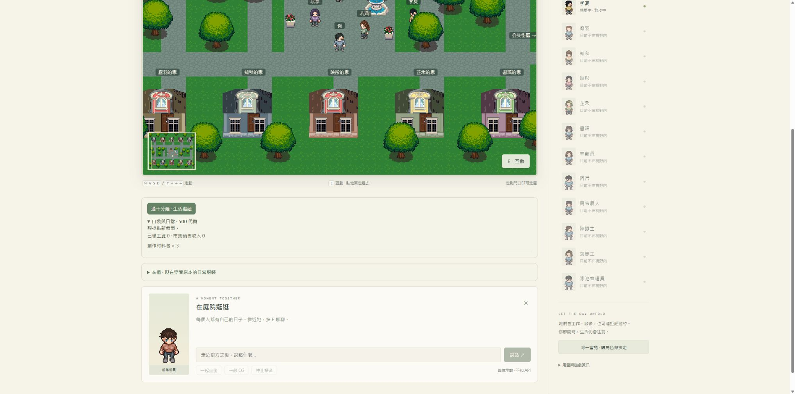
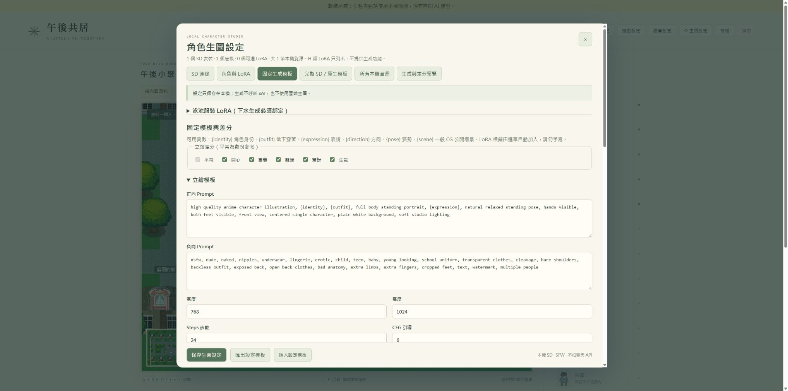
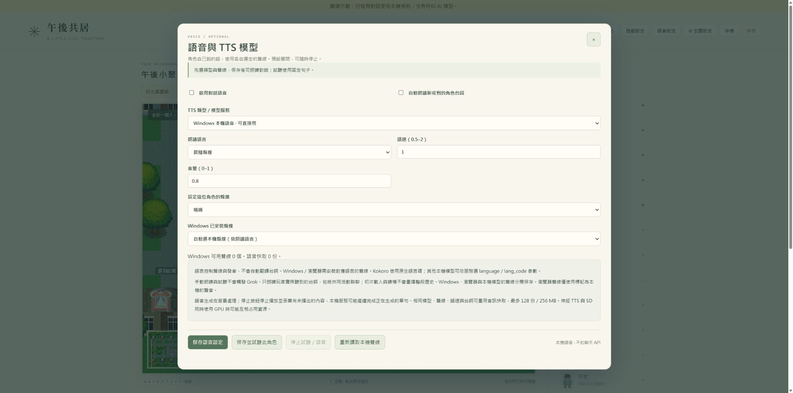
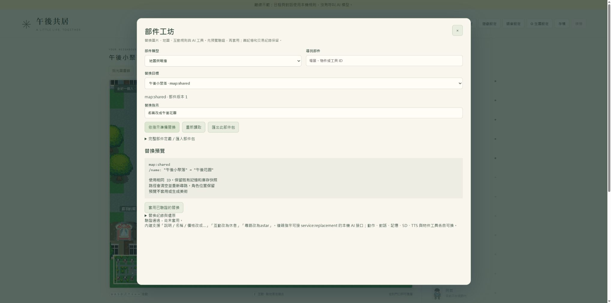
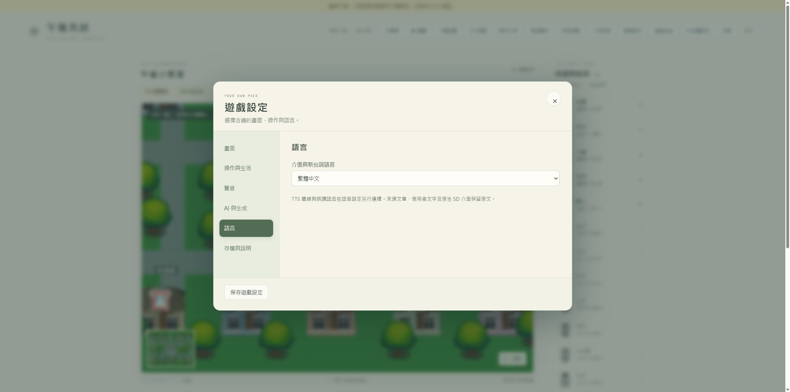

# 午後共居玩法百科 · v0.22

從第一次進入小鎮，到一次保存完成自訂人物。以下截圖為實際操作的獨立離線世界；SD 流程圖使用署名素材模擬出圖，非真實 SD 品質展示。

## 開始你的下午

### 先選哪個入口？

已有進度就按「繼續遊戲」；「新遊戲」先設定人物模板，再勾選建立新存檔。原存檔會封存，可從人物工坊恢復。「人物工坊」可以直接編輯男主或十位共居角色。

### 第一次試玩

離線示範不需要聊天 API 或 SD；它使用固定台詞和本機日程。真實 AI 對話需要已配置的模型服務；SD 出圖另需正在執行的本機 SD。畫面上的離線標示會說明目前模式。

### 保存與恢復

遊戲有自動進度，也可按「存檔」留下手動版本。讀檔不會讓已使用的 API 額度回退。新遊戲會保留原存檔；恢復後使用原來的人物與世界進度。

## 一次完成你的人物

### 最短操作：名字＋prompt＋保存

在左側選男主或共居角色，輸入自訂名字與「角色 prompt」，按「保存並完成這位人物」。目前人物的設定立即保存；立繪差分、四方向行走圖和一張 CG 會排入同一個 SD 佇列，完成後自動套用，不需要逐頁保存或逐張套用。

### 一份 prompt 怎麼寫？

用固定的外觀特徵，例如 adult woman, long black hair, brown eyes, round glasses, casual long-sleeved clothes。場景與動作放在「生成細節與 CG 情境」，避免把咖啡廳背景寫進所有行走圖。年齡與性別由上方人物欄位指定；人物皆需成年。

### LoRA 是可選的

可直接使用底模與 prompt，也可從選單選本機角色 LoRA。支援 <lora:檔名:0.8> 形式的標籤：依本機唯一同名資源解析，第一個作為角色 LoRA、第二個作為服裝 LoRA，不會猜另一個模型。找不到、重名或架構不相容時顯示原因。觸發詞依模型自己的要求填寫。

### 原來的人物備援功能都在

同一頁向下可調臉型、眼睛、膚色、身高、身形、八種髮型、髮色和起始便服配色；可設定個性、語氣、目標、可選背景，以及 AI 草擬與人物卡。勾選外觀細節後，這些控制也進入 SD 描述並更新原生像素備援；未勾選時由角色 prompt 主導。

### 名字與背景

男主與每位共居角色都能改名字，最多32字，名字需不同。名字會顯示在人物名單、對話、邀約及 SD／TTS 選單；固定人物 ID 和過去記憶不變。背景只屬於該人物，不能製造不存在的收入、交往或過去事件。

### 人物卡與 AI 草擬

AI 草擬是可選的手動操作，結果先放進同一個編輯器；正式模式會使用既有模型與用量上限，離線模式給明示範例。人物卡可匯入／匯出設定 JSON，含外觀與背景，不包含金鑰、世界記憶、錢包、模型權重或圖片。

## 看進度、重試與替換

### 完整進度

左側顯示立繪差分與行走圖、CG 的階段及是否已套用。GPU 忙時會等候佇列；SD 未連線、底模未選或模板缺少必要綁定時，人物仍會保存，素材階段顯示原因，修好後按「重試未完成項目」。

### 自動套用的範圍

套用前核對人物、已保存設定、LoRA 配方與實際穿著。生成期間改了人物或換衣服，舊任務不會覆蓋新角色；舊文件保留。單改名字且美術配方沒有變化，可重用完成素材，避免重做。

### 想選另一張？

打開「素材成果」，點縮圖看立繪、表情、行走表或 CG。可選其他表情或歷史素材；這個入口也提供單獨重做。單獨重做的任務完成後由你選用。

### 停止與恢復

停止這次生成只停止該人物的這次任務，不中斷其他人的 SD 工作。恢復原生／匯入美術保留已生成文件。新的保存會取代舊的自動套用計畫；部分失敗可保留已完成的素材。

## 移動、聊天與公共場所

### 怎麼走與互動？

WASD 或方向鍵移動，點地面會尋路；點場所按鈕會安排實際步行路線，走到門口即可進屋。靠近人物或物件按 E 互動。角色不在視野內時，不會把她的私有活動當成玩家已知事實。

### 怎麼聊天？

走近人物，按 E，再在對話框輸入。對話使用目前設定的模型；離線示範是本機台詞，不是 LLM 回覆。角色有各自的語氣、目標、需要與記憶，可能工作、散步、拒絕邀約。

### 可以去哪裡？

圖書館閱讀並連到原始線上來源；咖啡廳購買飲品；動物園觀察動物；美術館看展；電影院看公開免費電影；餐廳吃飯；公園散步休息；市集交易；衣服店買衣服；游泳池游泳。到場後選可用物件或品項，費用與時長在介面顯示。

### 外部內容怎麼理解？

場所保存來源連結、文字介紹與內容摘要，角色透過文字理解自己實際參與的活動。目錄為已有資料快照，並非所有線上網站的即時庫存或當期展覽；原書、影片與網站仍開啟各自來源。

## 共同活動、街坊與公共事件

### 多人邀約

按「共同活動」，填名稱，選場所與共同品項，勾同伴並設定集合時間，發出邀約。每個人自行答應或拒絕、走到集合點，並支付自己的費用；邀請者與至少一位同伴實際到場才開始。

### 沒到場會怎樣？

開始時間後最多等待十分鐘。缺席者沒有活動內容、群聊或付款記憶；尚未開始時取消不收費。途中離開不會自動退回已購品項費用。免費散步也可以成為共同活動。

### NPC 與小鎮事件

「小鎮活動」可看祭典、展覽、腳本街坊與自主交流。AI 角色可和其他 AI 或一般 NPC 相遇；只有到場或聽到內容的人取得相應記憶。可在部件工坊導入 NPC 腳本與公共活動定義。

## 背包、收入、市集與衣櫃

### 男主的背包

展開「口袋與日常」，查看代幣、需要、收入與物品數量。消耗品按「使用一份」會減少庫存；創作材料用於作品。購買是否成為背包物品或直接進行活動，依品項本身的互動方式。

### 收入與創作

可在提供工作的位置打工，時間完成後領工資；回家使用材料創作物品，再帶到市集寄售。角色也有自己的收入、庫存、欲望與工作，不與玩家共用錢包。

### 市集買賣

到市集後，作品可寄售，設定數量與價格；成交收入歸賣家。玩家可買角色的作品，也可收攤取回自己的寄售品。上架不代表立即成交。

### 衣櫃與泳池

衣服店購買後進自己的衣櫃，回可換裝的房間選「換上這套」。行走圖和 SD 配方讀取實際穿著。泳池互動要求泳裝；泳裝 SD 生成仍需在進階設定綁定對應服裝 LoRA。擁有衣服不等於已穿上。

## 進階 SD 與原生固定模板

### 第一次連接

進階 SD 的「SD 連線」選實際安裝資料夾、API 位址、底模與必要參數，按「保存並測試 SD 連線」。找得到模型文件不代表服務已啟動。之後人物工坊會使用這套已保存配置，無須每位人物重設底模。

### 已經在原生 SD 調好？

原生視窗中的設定不會被外層「保存生圖設定」擷取。先下載用該設定生成的原始 PNG，收起 SD 視窗，在「從原生 SD 保存新模板」匯入 PNG／PNG Info／完整 API JSON，保存為固定模板，再為立繪、像素或一般 CG 指定用途並保存三種用途的選擇。這是一次性的流程設定。

### ADetailer、放大與後製

原生模板保留其 API 能表達的擴充參數。PNG 只能攜帶 SD 寫入的生成參數；未寫入的 ADetailer 或其他擴充值需完整 API payload。遊戲會替換主 prompt、負向、種子、底模與所選人物；一鍵人物流程也會讓 WebUI 的 ADetailer 正向提示跟隨同一人物與表情，保留偵測器、遮罩、負向和其他後製參數。原生模板本身與原生 SD 視窗不改寫。

### ComfyUI 與不同用途

ComfyUI 使用 Export (API) 工作流或已完成紀錄，綁定人物、底模、LoRA、參考圖與 denoise 等欄位。包含角色 LoRA 節點的原生流程仍需選 LoRA；純 prompt 可用遊戲內建流程。立繪、像素與 CG 可各選不同模板，不要假設一張插圖的構圖設定就適合所有行走方向。

### 模板變數

內建固定模板可用 {identity}、{outfit}、{expression}、{direction}、{pose}、{scene}。人物 prompt 是身份，當下衣服是穿著，差分改表情，CG 再加入場景。立繪差分快取可複用；CG 表達一次構圖。

## 語音、語言與用量

### 每人自己的聲線

開「語音設定」，選 Windows、瀏覽器本機聲線、Kokoro 或其他本機相容 TTS 服務，指定人物、朗讀語言與聲線，再保存或試聽。神經 TTS 需先啟動相容服務；下拉選模型不等於自動安裝權重。

### 語音不等於翻譯

TTS 語言控制聲線與發音。遊戲設定可選繁中、簡中、日文與英文，影響介面和新台詞指引；人物名字、自訂背景、舊台詞、來源文章與原生 SD prompt 保留原文。

### 控制用量

動作、對話、記憶、SD 和 TTS 各有自己的接口；角色聊天沿用已配置的模型。SD 本機出圖與本機朗讀不扣聊天 API；AI 草擬與實際模型台詞會使用既有上限。「用量與遊戲資訊」可查看帳本，取消或讀檔不會重置已發生的 API 使用。

## 替換地圖、美術、互動與 AI

### 用一句指示替換

開「部件工坊」，選部件類型和目標，輸入如「名稱改成午後花園」，按「依指示準備替換」。先看欄位差異與相容性，再套用。範例截圖只顯示預覽，尚未改世界。

### 可以換哪些？

地圖碰撞、門口、互動物件、背景和 PNG 素材、場所目錄、單品、服裝配方、人物、NPC 腳本、公共活動、底層規則、模型服務、自訂工具與介面配色。完整 JSON 與部件包可匯入／匯出。

### 還原與自訂工具

替換紀錄保存舊值，可建立還原預覽再套用。固定 ID 保留既有記憶、交易和庫存。內建指示解析有明確支援範圍，複雜要求可接本機替換 AI 服務；語句不是任意執行電腦程式的命令。

## 遊戲設定與常見問題

### 畫面與操作

遊戲設定提供視野縮放、人物名字、小地圖、減少動畫與較大文字。設定不修改碰撞或人物記憶；暫停可以觀察畫面，但明確執行的遊戲操作仍會按規則推進。

### 按保存沒出圖？

先看人物進度的原因。未選底模、SD API 離線、LoRA 家族不相容、泳裝未綁定、ComfyUI 模板缺綁定，都會保留人物而阻擋生圖。修正進階設定後重試；名稱重複、未成年或無效 prompt 會在保存前拒絕。

### 圖片不是我想要的？

先修角色 prompt 或 LoRA，重新保存；改表情清單或姿勢模板到進階 SD。種子與身份參考能減少變化，無法保證絕對相同臉孔或完美動作。名字、外觀與個性是不同欄位，圖片不會自行替你編造人物背景。

### 百科畫面代表什麼？

本百科截圖來自獨立離線測試世界。人物素材流程使用明示的模擬 SD，示例圖片是已署名 LPC 素材，驗證介面與自動套用，不代表新生成的 SD 品質；正式人物、模型、存檔與工作流不在公開百科中。

## 介面參考與素材署名

人物工坊的名單、人物預覽、分類控制與人物卡操作參照 AI＊少女 的手冊組織方式；本遊戲使用原創介面與像素／SD 流程，不含其程式、美術或 3D 捏人資產。

[AI＊少女 手冊](https://aisteam.illusion.rip/manual/readme_jp.html) · [本專案素材授權](../ASSET_LICENSES.md)

## 補充：每位人物的底模與畫風（v0.23）

在人物工坊選好人物，於角色 prompt 下方選「此角色底模」與「畫風 LoRA」。底模可沿用全局設定；畫風可留空。權重先依模型作者建議，觸發詞填入作者提供的文字，再按「保存並完成這位人物」。立繪差分、行走圖與 CG 使用相同配方；不會把選擇套到其他人。要取消角色底模覆寫，改選「沿用全局底模」並保存。

此截圖為隔離介面測試，圖片是已署名 LPC 模擬成果。選單只列目前安裝內可用的資源；已知架構不相容會阻擋生成。原生 ComfyUI 模板需另綁畫風節點的 style_lora/style_weight，否則使用內建模板。
