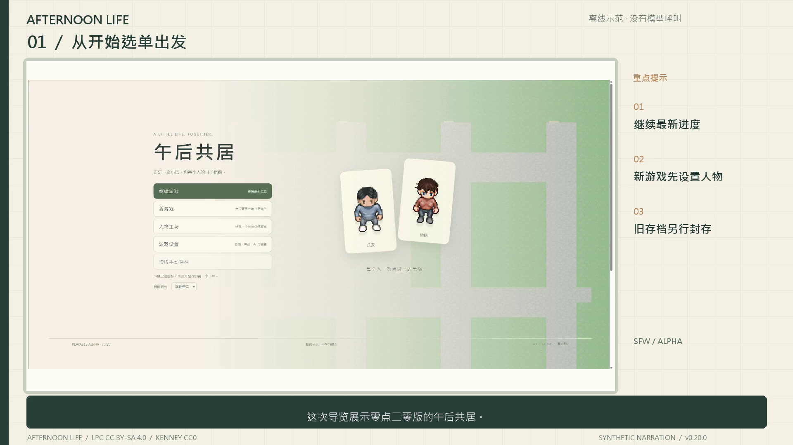

# 已录制的游戏导览

[繁體中文](WALKTHROUGH.zh-TW.md) · **简体中文** · [日本語](WALKTHROUGH.ja.md) · [English](WALKTHROUGH.en.md)

## 简体中文 · v0.20

[影片 · 7:37](https://github.com/tray11415-cloud/afternoon-life/releases/download/v0.20.0/afternoon-life-guide.zh-CN.mp4) · [字幕](https://github.com/tray11415-cloud/afternoon-life/releases/download/v0.20.0/afternoon-life-guide.zh-CN.srt) · [解说稿](https://github.com/tray11415-cloud/afternoon-life/releases/download/v0.20.0/afternoon-life-guide.zh-CN.script.md)

影片展示开始选单、分类设置、像素捏人、手动离线人物草拟、实际步行、背包购买、共同邀约、本机SD设置与部件预览／套用／还原。使用1023张带时间浏览器截图，约4fps撷取、25fps编码，部分片段尾端停留供解说。界面与字幕为简体，配音为本机Microsoft Hanhan合成音声，八个主要章节加开场。无现场付费模型或SD生图。制片时已通过完整解码与非静音检查；翻译文件不重跑。

像素预览是真实图层合成，AI草拟是明示本机例子。人物卡汇出成功；自动化浏览器的本机档案上传权限受限，因此未完成该浏览器的卡片选档实测，后端验证与一般手动选择仍保留，未扩充浏览器权限。

| 章节 | 开始 |
|---|---:|
| 开场 | 0:00 |
| 开始选单 | 0:19 |
| 按自己的步调设置 | 1:09 |
| 像素人物 | 2:00 |
| 离线人物草拟 | 2:51 |
| 咖啡厅与背包 | 3:43 |
| 共同邀约 | 4:42 |
| 本机SD连线 | 5:32 |
| 部件与世界保留 | 6:26 |

## 繁体中文与英文 · v0.19

[繁中 · 5:20](https://github.com/tray11415-cloud/afternoon-life/releases/download/v0.19.0/afternoon-life-guide.zh-TW.mp4) · [英文 · 5:28](https://github.com/tray11415-cloud/afternoon-life/releases/download/v0.19.0/afternoon-life-guide.en.mp4)

两版以各自界面语言分别录制，含八章、合成解说、内嵌字幕、章节标记、封面与重点提示。这些是旧版本纪录，不是当前功能证据。

| 章节 | 繁中 | 英文 |
|---|---:|---:|
| 小镇行走 | 0:00 | 0:00 |
| 咖啡与背包 | 0:47 | 0:45 |
| 共同活动 | 1:28 | 1:36 |
| 人物设置 | 2:06 | 2:15 |
| 部件与还原 | 2:40 | 2:48 |
| 美术替换 | 3:15 | 3:24 |
| SD与CG设置 | 3:49 | 3:58 |
| 语言与音声 | 4:28 | 4:37 |

[繁中字幕](https://github.com/tray11415-cloud/afternoon-life/releases/download/v0.19.0/afternoon-life-guide.zh-TW.srt) · [繁中稿](https://github.com/tray11415-cloud/afternoon-life/releases/download/v0.19.0/afternoon-life-guide.zh-TW.script.md) · [英文字幕](https://github.com/tray11415-cloud/afternoon-life/releases/download/v0.19.0/afternoon-life-guide.en.srt) · [英文稿](https://github.com/tray11415-cloud/afternoon-life/releases/download/v0.19.0/afternoon-life-guide.en.script.md)

## 展示范围

实际操作包括步行、游戏代币外带购买、物品消耗、多人邀约、人物修改预览、部件说明预览／套用／还原。美术汇入与SD／CG展示设置，不主张新生成。共同活动是本机多角色事件，不是连线多人。

独立世界使用本机日程与固定示范台词，不是LLM。角色未绑生成模型。本机Microsoft Hanhan Desktop与Microsoft Zira Desktop提供合成声线。影片未使用付费模型、私人存档、金钥或个人生成设置。

游戏画面是带时间浏览器撷取，剪入章节卡并有片尾停留。1920×1080、25fps是成片规格，不是撷取帧率。字幕依实测解说段落排定，句长推算句子时间，不使用生图模型伪造画面。

分享时保留[美术署名](../ASSET_LICENSES.md)：LPC改作为CC BY-SA 4.0，Kenney为CC0。旧无声短版保留为早期纪录。本页提供四语文件；原影片与配音仍保留上述标示的原始语言。
